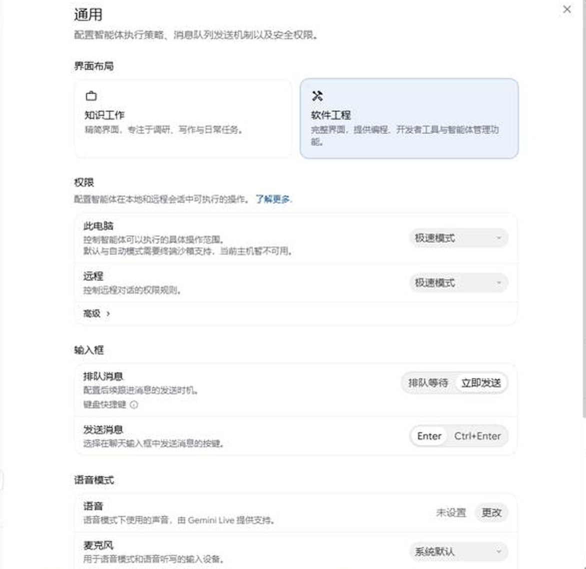
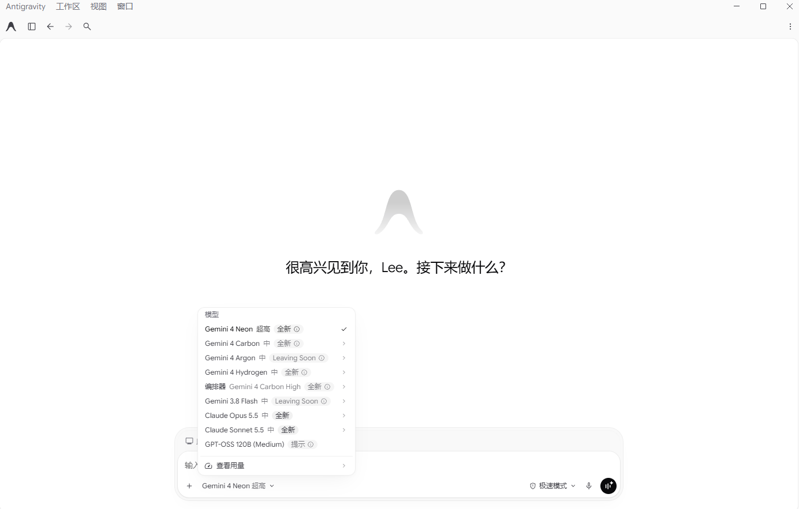
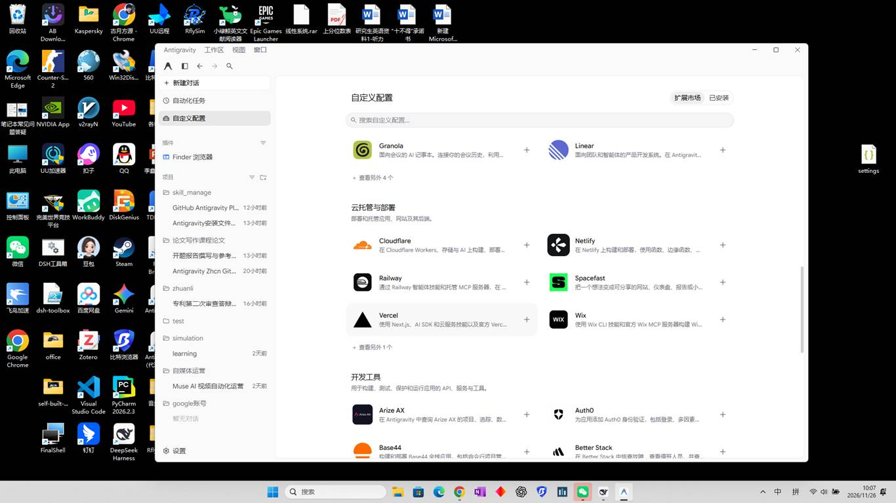
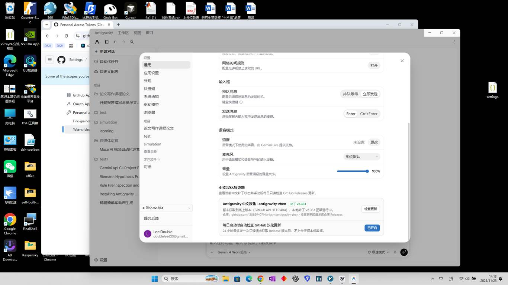

# Antigravity 中文汉化（antigravity-zhcn）

**简体中文** | [English](README_EN.md)

面向 **Google Antigravity 桌面版** 的简体中文汉化工具：合并三份社区词库为 **8188 条**主词典，
配合 DOM 热翻译引擎（含 Shadow DOM、动态文案规则）、设置页内更新检查、漏翻自动收集与一键安装 / 无损还原。

已在 **Antigravity 2.35.2（Windows x64 / Electron 44.9.1）** 实测：菜单栏、全部设置分页、快捷键列表、
模型与用量、项目设置、对话输入框均为中文，代码块与编辑器内容不被误翻。







---

## 快速开始

**环境**：Windows / macOS / Linux，Python 3.8+；Node.js 18+ 只用于 JS 语法自检，没有也能装（自动跳过校验）。

### 方式一：把这段提示词交给本机 AI Agent（推荐，全自动）

复制下面**整段**，粘给你电脑上的 Agent（Claude Code / Cursor / Codex / Antigravity 自身都可以）。
它会自己下载项目、退出客户端、完成安装、验证界面，并截图汇报：

```text
帮我在这台电脑上安装 Google Antigravity 的简体中文汉化。直接开始执行，不要先问我权限。

1. 确认系统（Windows / macOS / Linux）与 Python 3.8+；没有 Python 就先安装。
2. 获取汉化工程（任选一种）：
   git clone https://github.com/13083940714lx-lgtm/antigravity-zhcn
   或下载 https://github.com/13083940714lx-lgtm/antigravity-zhcn/archive/refs/heads/main.zip 并解压
3. 完全退出 Antigravity（Windows 可执行 taskkill /IM Antigravity.exe /F）。
4. 在工程目录执行：
   Windows:        python install.py install --close
   macOS / Linux:  python3 install.py install --close
   （之前装过旧版汉化就直接重跑，安装器是幂等的）
5. 确认输出里有「汉化完成！」「版本: <客户端版本>」「词条: 8188」。
6. 重新启动 Antigravity，检查菜单栏、设置页（Ctrl+,）、快捷键页是否中文，并把设置页截图给我。
7. 第 4 步若提示找不到安装目录，用 --app-dir "<Antigravity 安装目录>" 再执行一次。
8. 安装后界面仍为英文时，执行 python install.py status 并把输出贴给我。
9. 需要还原英文版：python install.py restore --close。

注意：不要删除 resources\app.asar.original.bak（官方原版备份）；不要改动我的项目与对话数据。
```

> Agent 只需要 Python；汉化只改本地界面文案，不改账号逻辑、不上传任何数据。

### 方式二：双击脚本（Windows）

1. 完全退出 Antigravity（托盘里也要退出）
2. 双击 `一键汉化.bat`
3. 启动 Antigravity，界面即为中文

### 方式三：命令行（任意平台）

```bash
python install.py status    # 查看版本、词条数、是否已汉化、漏翻收集
python install.py install   # 安装 / 官方更新后重新打补丁
python install.py restore   # 从备份还原官方英文原版
```

安装前自动备份 `resources/app.asar.original.bak`，`restore` 就是把它拷回去，**无损、可反复**。

### 方式四：应用内检查更新

汉化后在 **设置（Ctrl+,）→ 通用 → 中文汉化与更新** 卡片：

- **检查更新**：请求本仓库 Releases，对比当前补丁与线上版本
- 出现「有新版 vX」时点 **打开发布页下载**：浏览器打开 Release 页面，下载最新安装包解压后重跑安装器
- 卡片底部「每日启动时自动检查」可以随时关掉，关掉后不再发任何网络请求



---

## 官方更新后怎么办

Antigravity 的自动更新会**直接覆盖** `resources/app.asar`，所以每次官方升级后界面都会退回英文——这是预期行为，不是汉化坏了。

**三步恢复**：

1. 等客户端更新完并自动重启后，完全退出 Antigravity
2. 重新运行安装器：`python install.py install --close`（或双击 `一键汉化.bat`）
3. 启动后即为中文，**配置、项目、对话记录都不受影响**

安装器已经针对「版本错配」做了保护：

- 检测到客户端版本变化时，旧备份归档为 `app.asar.original.bak.<旧版本>`，并重新备份当前原版再打补丁
- 重复执行是幂等的，不会叠加补丁
- 打包前后校验 JS 语法与 unpacked 文件集合

**大版本升级（例如 2.35 → 2.4x）后仍有漏翻？**
正常点一遍新出现的页面，然后运行 `python tools/report_missing.py`，把 `needs translation` 清单提到本仓库 Issue，
或自己写进 `assets/overrides.json` 后重跑安装器（详见下方「词库维护流程」）。

**不想反复失效？** 可以关掉官方后台静默下载：

```bash
python install.py install --block-auto-update
```

（保留手动「检查更新」菜单，但不再后台下载安装包。）

---

## 本项目相对上游做了什么

本项目的词库与 DOM 引擎基于下列优秀开源项目（MIT），在此郑重致谢：

| 上游项目 | 本项目使用的内容 |
| --- | --- |
| [**ruxiayu/antigravity-zh-cn**](https://github.com/ruxiayu/antigravity-zh-cn) | 主词典 6767 条、DOM 翻译引擎、ASAR 编解码器与主进程补丁（`vendor/`） |
| [**yuexps/Antigravity-Hans**](https://github.com/yuexps/Antigravity-Hans) | 增补 891 条词条（IDE 侧 NLS 与设置面板文案） |
| [**nkjDSLcvanv/antigravity-codex-theme**](https://github.com/nkjDSLcvanv/antigravity-codex-theme) | 增补 465 条词条（覆盖 2.30–2.34 设置面板） |

在上述基础上，**本项目做的优化**：

1. **词库合并扩到 8188 条**：三份词库去重合并，补齐单一项目缺失的条目（如 `Input Box`、`Reasoning Effort`、
   `Choose which key sends a message in the chat composer.` 等上游漏翻项）。
2. **新增动态文案规则**（上游未覆盖）：
   - `Version 2.34.0` → `版本 2.34.0`
   - `Permanently deletes <项目> including N active conversations.` → `永久删除 <项目>，包括 N 个活跃对话`
   - `N active conversations` → `N 个活跃对话`（修复项目设置页残留英文）
   - `Send feedback as <邮箱>` → `以 <邮箱> 身份发送反馈`
3. **漏翻自动收集系统**（本项目新增）：
   渲染层收集器（二次确认去噪，跳过代码块 / 编辑器 / 输入框）→ IPC → 主进程落盘
   `%APPDATA%\Antigravity\agy-zh\missing.jsonl`；`tools/report_missing.py` 自动过滤品牌名、标识符、快捷键、邮箱，
   只输出真正漏翻的条目。官方改版后可快速闭环补词，不再靠人眼找漏。
4. **更新检查指向本仓库**：设置页「中文汉化与更新」卡片与菜单「检查更新」原本请求上游 Releases，
   现已重定向到本仓库（`install.py` 的 `retarget_upstream_links`），避免误升级回上游精简版而丢掉增强规则与漏翻收集。
5. **安装器工程化**：
   - 单文件 Python 安装器，`status / install / restore / build` 四个子命令
   - 自动备份 + 幂等重打补丁（重复安装不会叠加补丁）
   - 打包前后 JS 语法自检（`node --check`）、unpacked 文件集合一致性校验
   - 自动探测 Node.js 路径，无需手动配 PATH
   - 跨平台状态目录（Windows `%APPDATA%` / macOS `Application Support` / Linux `XDG_CONFIG_HOME`）
6. **可读的交付结构**：`assets/`（词库 / 引擎 / 收集器）与 `vendor/`（上游代码）分离，
   上游补丁逻辑保持可追溯，本项目的改动集中在 `install.py` 与 `assets/`。
7. **扩展市场 / 插件目录文案**：Google Workspace、Gmail、Cloudflare、Docusign、n8n、Better Stack、Arize AX、
   Spacefast、ClickUp、Granola 等 20+ 集成的描述与分类名（科学文献 / 结构生物学 / 质谱分析）已中文化，
   并新增「`See N more` → 查看另外 N 个」动态规则；收集器单条上限由 140 提到 260 字符，长描述也能被纳入。

---

## 词库维护流程

官方更新后如果发现新的英文残留：

1. 正常使用 Antigravity，把各页面点一遍（收集器自动记录）
2. `python tools/report_missing.py` 查看 `needs translation` 清单
3. 把译文写进 `assets/overrides.json`（`"English": "中文"`）
4. `python install.py install --close` 重新安装

说明：`overrides.json` 里的条目优先级高于主词典，适合放动态句子的固定译法；
带数字 / 版本号 / 邮箱的句子请改 `install.py` 的 `ENGINE_EXTRA` 正则规则。

---

## 目录结构

```
antigravity-zhcn/
├─ install.py                 安装器：status / install / restore / build
├─ 一键汉化.bat               Windows 双击安装
├─ 还原英文.bat               Windows 双击还原
├─ assets/
│  ├─ dict.json               主词典 8188 条
│  ├─ overrides.json          本项目增补 / 覆盖词条
│  ├─ engine_preload.js       DOM 翻译引擎模板
│  ├─ collector.js            漏翻收集器（渲染进程）
│  └─ agy-zh-main.js          漏翻落盘（主进程）
├─ vendor/                    上游 MIT 代码：ASAR 编解码 + 主进程补丁
├─ tools/report_missing.py    漏翻分析
└─ docs/                      截图
```

---

## 常见问题

**官方自动更新后变回英文？**
双击 `一键汉化.bat` 重新打补丁即可，配置与对话记录不受影响。

**设置页里的「检查更新」点了会怎样？**
请求本仓库的 Releases（`13083940714lx-lgtm/antigravity-zhcn`）。若本仓库尚未发布 Release，会提示"暂未获取到线上版本"，
不影响本地汉化。发布 Release 后在应用内即可直接更新。

**会上传数据吗？**
不会。汉化只改本地界面文案；更新检查仅在开启时请求一次 Releases 版本号；漏翻收集只写本地文件。

**代码会被翻译吗？**
不会。引擎跳过 `code / pre / kbd`、编辑器（Monaco / CodeMirror）、输入框与用户消息。

---

## 免责声明与许可

本项目仅提供本地界面汉化脚本与词库，与 Google / Antigravity 官方无任何从属关系，不含任何官方程序文件，
请从官方渠道获取客户端。使用本工具造成的任何问题由使用者自行承担。

以 [MIT License](LICENSE) 发布。词典与引擎的著作权归上游作者所有，详见 LICENSE 中的署名。
