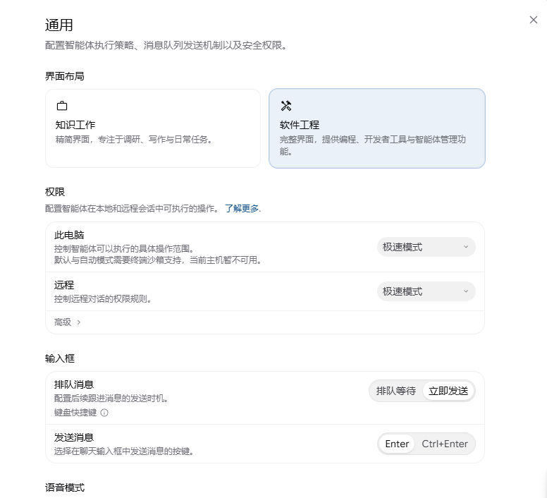
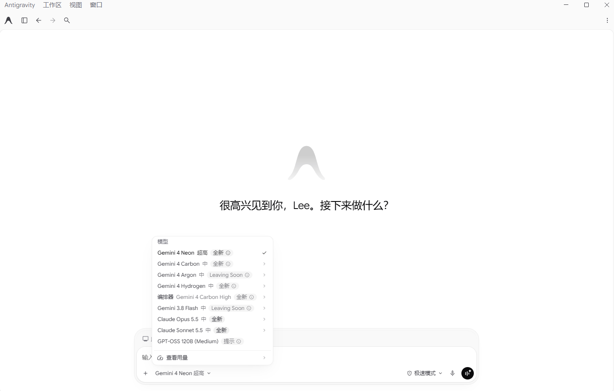

# Antigravity Chinese Localization (antigravity-zhcn)

[简体中文](README.md) | **English**

Simplified Chinese localization for the **Google Antigravity desktop app**. It merges three community dictionaries
into an **8,158-entry** main dictionary, pairs it with a hot DOM translation engine (Shadow DOM aware, with rules for
dynamic strings), an in-app update checker, automatic untranslated-text collection, and one-command install / lossless restore.

Verified on **Antigravity 2.34.0 (Windows x64 / Electron 44.9.1)**: menu bar, every settings page, keyboard shortcut list,
model & quota page, project settings and the chat composer are all Chinese, while code blocks and editor content are left untouched.





---

## Quick start

**Requirements**: Windows / macOS / Linux with Python 3.8+. Node.js 18+ is only used for the JS syntax self-check —
installation works without it (the check is skipped).

### Option 1: Hand this prompt to your local AI agent (recommended)

Copy the whole block below to the agent on your machine (Claude Code / Cursor / Codex / Antigravity itself).
It downloads the project, quits the client, installs, verifies the UI and reports back with a screenshot:

```text
Please install the Simplified Chinese localization for Google Antigravity on this machine.
Start executing immediately; do not ask for permission first.

1. Confirm the OS (Windows / macOS / Linux) and Python 3.8+; install Python first if missing.
2. Fetch the project (either way):
   git clone https://github.com/13083940714lx-lgtm/antigravity-zhcn
   or download https://github.com/13083940714lx-lgtm/antigravity-zhcn/archive/refs/heads/main.zip and unzip it
3. Quit Antigravity completely (on Windows: taskkill /IM Antigravity.exe /F).
4. Inside the project directory run:
   Windows:        python install.py install --close
   macOS / Linux:  python3 install.py install --close
   (if an older localization is installed, just re-run — the installer is idempotent)
5. Confirm the output contains "汉化完成！", "版本: <client version>" and "词条: 8158".
6. Restart Antigravity, check the menu bar, Settings (Ctrl+,) and the keyboard shortcuts page are Chinese,
   then send me a screenshot of the settings page.
7. If step 4 says the installation directory cannot be found, re-run with
   --app-dir "<Antigravity install dir>".
8. If the UI is still English, run python install.py status and paste the output.
9. To restore English: python install.py restore --close.

Notes: do not delete resources\app.asar.original.bak (the original backup); do not touch my projects or chats.
```

> The agent only needs Python. Localization changes UI strings on disk only — no account logic, no data upload.

### Option 2: Double-click (Windows)

1. Quit Antigravity completely (including the tray icon)
2. Double-click `一键汉化.bat`
3. Start Antigravity — the UI is now Chinese

### Option 3: Command line (any platform)

```bash
python install.py status    # versions, dictionary size, localized?, collected gaps
python install.py install   # install / re-apply after an official update
python install.py restore   # restore the original English build from backup
```

The original `resources/app.asar` is backed up as `app.asar.original.bak` before patching, so `restore` is lossless
and the cycle can be repeated at any time.

### Option 4: In-app update check

After localization, open **Settings (Ctrl+,) → General → 中文汉化与更新**:

- **检查更新 / Check for updates**: queries this repository's Releases and compares versions
- When "有新版 vX" appears, click **打开发布页下载**: your browser opens the Release page; download the latest
  package, unzip it and re-run the installer
- The daily auto-check toggle at the bottom can be switched off; once off, no network requests are made at all

---

## After an official update

Antigravity's auto-updater **overwrites** `resources/app.asar`, so the UI goes back to English after every official
update. That is expected behaviour, not a broken patch.

**Three steps to recover**:

1. Let the client finish updating and restart, then quit Antigravity completely
2. Re-run the installer: `python install.py install --close` (or double-click `一键汉化.bat`)
3. Start it again — Chinese is back, and **settings, projects and chat history are untouched**

The installer protects you from version mismatch:

- If the client version changed, the old backup is archived as `app.asar.original.bak.<old version>`, the new original
  is backed up, and patching starts from it
- Re-running is idempotent — patches never stack
- JS syntax and unpacked-file parity are verified before deployment

**Still seeing English after a big upgrade (e.g. 2.35 → 2.4x)?**
Visit the new pages once, run `python tools/report_missing.py`, and file the `needs translation` list as an Issue —
or add entries to `assets/overrides.json` and re-run the installer (see "Maintaining the dictionary").

**Tired of re-patching?** Disable silent background downloads of official updates:

```bash
python install.py install --block-auto-update
```

(The manual "check for updates" menu item stays; only background downloads are disabled.)

---

## What this project adds on top of upstream

The dictionary and the DOM engine come from these excellent MIT-licensed projects. Many thanks to their authors:

| Upstream project | Used here |
| --- | --- |
| [**ruxiayu/antigravity-zh-cn**](https://github.com/ruxiayu/antigravity-zh-cn) | 6,767-entry main dictionary, DOM engine, ASAR codec and main-process patches (`vendor/`) |
| [**yuexps/Antigravity-Hans**](https://github.com/yuexps/Antigravity-Hans) | +891 entries (IDE-side NLS and settings copy) |
| [**nkjDSLcvanv/antigravity-codex-theme**](https://github.com/nkjDSLcvanv/antigravity-codex-theme) | +465 entries (covers the 2.30–2.34 settings panel) |

**Improvements made by this project**:

1. **Dictionary merged and extended to 8,158 entries** — deduplicated merge of the three sources above, filling gaps
   that no single project covered (e.g. `Input Box`, `Reasoning Effort`,
   `Choose which key sends a message in the chat composer.`).
2. **New dynamic-string rules** (not covered upstream):
   - `Version 2.34.0` → `版本 2.34.0`
   - `Permanently deletes <project> including N active conversations.` → `永久删除 <project>，包括 N 个活跃对话`
   - `N active conversations` → `N 个活跃对话` (fixes leftover English on the project settings page)
   - `Send feedback as <email>` → `以 <email> 身份发送反馈`
3. **Automatic untranslated-text collection** (new): a renderer-side collector with two-pass confirmation
   (skips code blocks, editors and inputs) reports through IPC to the main process, which appends to
   `%APPDATA%\Antigravity\agy-zh\missing.jsonl`. `tools/report_missing.py` filters out brand names, identifiers,
   key names and e-mails, leaving only real gaps — so future upstream UI changes can be closed quickly.
4. **Update check points at this repository**: the settings-page "update" card and the menu item used to query the
   upstream Releases. They are now redirected to this repo (`retarget_upstream_links` in `install.py`), so an accidental
   upgrade cannot silently replace this build with a slimmer upstream one.
5. **Engineered installer**:
   - single-file Python installer with `status / install / restore / build`
   - automatic backup and idempotent re-patching (no patch stacking)
   - JS syntax verification (`node --check`) and unpacked-file parity checks before/after packing
   - automatic Node.js detection, no PATH setup needed
   - cross-platform state directory (Windows `%APPDATA%`, macOS `Application Support`, Linux `XDG_CONFIG_HOME`)
6. **Traceable layout**: `assets/` (dictionary / engine / collector) is separated from `vendor/` (upstream code), so this
   project's changes stay concentrated in `install.py` and `assets/`.

---

## Maintaining the dictionary

When an official update introduces new English text:

1. Use Antigravity normally and visit the pages once (the collector records gaps in the background)
2. `python tools/report_missing.py` prints a `needs translation` list
3. Add translations to `assets/overrides.json` (`"English": "中文"`)
4. Re-run `python install.py install --close`

Entries in `overrides.json` win over the main dictionary. Sentences containing numbers, version numbers or e-mails should
be handled as regex rules in `ENGINE_EXTRA` inside `install.py`.

---

## Layout

```
antigravity-zhcn/
├─ install.py                 installer: status / install / restore / build
├─ 一键汉化.bat               one-click install (Windows)
├─ 还原英文.bat               one-click restore (Windows)
├─ assets/
│  ├─ dict.json               8,158-entry main dictionary
│  ├─ overrides.json          project-level additions / overrides
│  ├─ engine_preload.js       DOM translation engine template
│  ├─ collector.js            untranslated-text collector (renderer)
│  └─ agy-zh-main.js          collector sink (main process)
├─ vendor/                    upstream MIT code: ASAR codec + main-process patches
├─ tools/report_missing.py    gap analysis
└─ docs/                      screenshots
```

---

## FAQ

**An official auto-update reverted the UI to English.**
Double-click `一键汉化.bat` to re-apply; settings and chat history are untouched.

**What happens if I click "check for updates" in settings?**
It queries this repo's Releases (`13083940714lx-lgtm/antigravity-zhcn`). Until a release is published it reports that no
online version was found, which does not affect the local localization.

**Does it upload anything?**
No. Only local UI strings are changed; the update check requests a release version at most once per day when enabled;
collected gaps stay in a local file.

**Will my code be translated?**
No. The engine skips `code / pre / kbd`, editors (Monaco / CodeMirror), inputs and user messages.

---

## Disclaimer & license

This project only ships local UI localization scripts and dictionaries. It is not affiliated with Google or Antigravity
and contains no official program files; obtain the client from official channels. Use at your own risk.

Released under the [MIT License](LICENSE). Dictionary and engine copyrights remain with their upstream authors —
see the attribution section in LICENSE.
